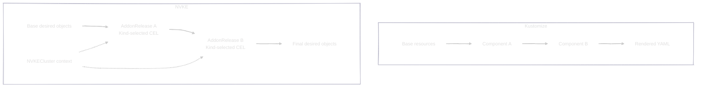

# Support Accelerated Cluster Addons

**Status:** proposed
**Date:** 2026-11-23

## Context

In a bare-metal accelerated environment, enabling a single add-on or capability can require coordinated configuration across infrastructure, node setup, and Kubernetes resources. These settings describe one capability but are consumed by different parts of the provisioning stack.

The primary purpose of this ADR is to define the enablement of that capability.

## Decision

A single capability can require coordinated configuration across multiple independently reconciled objects. We will express that coordination as transformations of the desired objects during cluster provisioning, using NVKECluster as shared context.

[SysCMP](https://github.com/NVIDIA/cluster-api-addon-provider-syscmp) will deliver the cluster runtime configuration.

 ```mermaid
   %%{init: {"theme": "redux-dark-color", "look": "handDrawn"}}%%
   flowchart LR
       cluster["NVKECluster"]
       channel["AddonReleaseChannel"]
       release["AddonRelease"]

       cluster -.->|channel reference| channel
       channel -.->|release references| release

       cluster -->|intent and cluster context| resolve
       channel -->|Kubernetes-version mapping| resolve
       release -->|CEL transformations| resolve

       subgraph reconciler["NVKECluster reconciler"]
           resolve["Resolve selected add-ons"]

           resolve --> infra["LaunchLayerCluster.spec<br/>CEL(spec, cluster)"]
           resolve --> machine["LaunchLayerMachineTemplate.spec<br/>CEL(spec, cluster)"]
           resolve --> bootstrap["KubeadmConfigTemplate.spec<br/>CEL(spec, cluster)"]
           resolve --> controlPlane["KubeadmControlPlaneTemplate.spec<br/>CEL(spec, cluster)"]
           resolve --> runtime["SystemComponent.spec<br/>CEL(spec, cluster)"]
       end

       infra --> infraOut["DPU service version and API VIP"]
       machine --> machineOut["DPU offload configuration"]
       bootstrap --> bootstrapOut["Worker host configuration"]
       controlPlane --> controlPlaneOut["Control-plane host configuration"]
       runtime --> runtimeOut["Runtime bundle values"]

       classDef default fill:none;
       style reconciler fill:none;
 ```

### Composition as data flow

Add-on composition follows the same data-flow model as Kustomize components: begin with a set of base resources, then apply optional transformations in a declared order. Each stage receives the preceding stage's output, so later transformations can override earlier configuration.

NVKE constructs the base desired objects from cluster configuration. Selected AddonReleases act as transformation stages over those objects, using CEL and the NVKECluster as shared context. The resulting objects are then materialized and reconciled.



Within each add-on stage:

```text
For each desired object:
    matching Kind -> CEL(current spec, cluster) -> replacement spec
    unmatched Kind -> unchanged object
```

The analogy has two limits:

- **Kustomize components can add resources.** Initial NVKE add-ons only transform objects NVKE already constructs. Additional resource creation is [postponed](#features-considered-but-postponed).
- **Failure behavior differs.** Kustomize normally fails the build. NVKE discards a failing add-on's changes and continues.

### Selection and versions

Accelerated Addons will follow the same release and upgrade semantics as ClusterRelease and ClusterReleaseChannel.

Each cluster will declare an ordered list of add-on selections. Each selection will reference a release channel. The cluster's Kubernetes version determines which releases in that channel are eligible.

Add-on releases will be immutable. The resolved release will determine the add-on's inputs and configuration.

#### Resource Example

The names and fields below are illustrative. AddonRelease and AddonReleaseChannel are cluster-scoped, NVKECluster is namespaced. Release content is immutable, while lifecycle metadata follows the existing ClusterRelease semantics.

The operator must provision the referenced SystemPackage out of band. The digest below is a placeholder.

```yaml
apiVersion: addons.cluster.x-k8s.io/v1alpha1
kind: SystemPackage
metadata:
  name: nais-1.0.0
spec:
  packageName: nais
  version: "1.0.0"
  oci:
    repository: addons/nais
    tag: "1.0.0"
    digest: "sha256:0000000000000000000000000000000000000000000000000000000000000000"
```

An AddonRelease binds a SysCMP package to CEL transformations. Each transformation selects a resource Kind and applies to all matching objects in the cluster.

- `spec`: the selected object's spec.
- `cluster`: the full NVKECluster object, available as read-only context.
- Return value: the complete transformed spec.

Example based on [Node setup for ovn-kubernetes in DPU mode](https://docs.google.com/document/d/1JaknOCGzq3yoEUKO8SBLJL9ijryWApusJF_pmGcOIk4/edit?tab=t.0).

```yaml
apiVersion: service.nvke.nvidia.com/v1
kind: AddonRelease
metadata:
  name: nais-1.0.0
spec:
  systemPackageRef:
    name: nais-1.0.0
  transformations:
    - kind: LaunchLayerCluster
      expression: |
        spec.deepMerge({
          "dpuServiceRegistration": {
            "naisVersion": "1.0.0",
            "k8sAPIServer":
              "https://" + cluster.spec.apiServerEndpoint.address + ":6443"
          }
        })
    - kind: LaunchLayerMachineTemplate
      expression: |
        spec.deepMerge({
          "template": {
            "spec": {
              "dpuOffload": true,
              "nodeLabels": {
                "k8s.ovn.org/dpu-host": ""
              }
            }
          }
        })
    - kind: KubeadmConfigTemplate
      expression: |
        spec.deepMerge({
          "template": {
            "spec": {
              "files":
                spec.template.spec.?files.orValue([])
                  .filter(f,
                    f.path != "/etc/sysctl.d/90-nais-host-ports.conf")
                + [{
                    "path": "/etc/sysctl.d/90-nais-host-ports.conf",
                    "owner": "root:root",
                    "permissions": "0644",
                    "content":
                      "net.ipv4.ip_local_port_range = 32768 39999\n"
                  }],
              "preKubeadmCommands":
                spec.template.spec.?preKubeadmCommands.orValue([])
                + [
                    "sysctl -p /etc/sysctl.d/90-nais-host-ports.conf"
                  ]
            }
          }
        })
    - kind: KubeadmControlPlaneTemplate
      expression: |
        spec.deepMerge({
          "template": {
            "spec": {
              "kubeadmConfigSpec": {
                "files":
                  spec.template.spec.kubeadmConfigSpec.?files.orValue([])
                    .filter(f,
                      f.path != "/etc/sysctl.d/90-nais-host-ports.conf")
                  + [{
                      "path": "/etc/sysctl.d/90-nais-host-ports.conf",
                      "owner": "root:root",
                      "permissions": "0644",
                      "content":
                        "net.ipv4.ip_local_port_range = 32768 39999\n"
                    }],
                "preKubeadmCommands":
                  spec.template.spec.kubeadmConfigSpec.?preKubeadmCommands.orValue([])
                  + [
                      "sysctl -p /etc/sysctl.d/90-nais-host-ports.conf"
                    ]
              }
            }
          }
        })
    # Just illustrates how one would set runtime config
    - kind: SystemComponent
      expression: |
        spec.systemPackageRef.name == "nais-1.0.0"
          ? spec.deepMerge({
              "values": {
                "podCIDRs": cluster.spec.clusterNetwork.pods.cidrBlocks,
                "serviceCIDRs": cluster.spec.clusterNetwork.services.cidrBlocks
              }
            })
          : spec
  lifecycle:
    deprecated: false
    hidden: false
```

An AddonReleaseChannel maps Kubernetes version selectors to add-on release candidates in operator preference order, following ClusterReleaseChannel. The map key "1.35" corresponds to the currently resolved kubernetes version.

```yaml
apiVersion: service.nvke.nvidia.com/v1
kind: AddonReleaseChannel
metadata:
  name: nais-stable
spec:
  releases:
    "1.35":
      - name: nais-1.0.0
        minimumUpgradeAge: 168h
    "1.36":
      - name: nais-1.1.0
        minimumUpgradeAge: 168h
```

The following partial NVKECluster shows ordered add-on selections. Each selection specifies only a channel, with no add-on version or per-cluster input overrides.

```yaml
apiVersion: service.nvke.nvidia.com/v1
kind: NVKECluster
metadata:
  name: example-cluster
  namespace: example-org
spec:
  apiServerEndpoint:
    address: 192.0.2.10
  clusterNetwork:
    pods:
      cidrBlocks:
        - 10.244.0.0/16
    services:
      cidrBlocks:
        - 10.96.0.0/12
    serviceDomain: cluster.local
  addons:
    - name: nais
      release:
        channel:
          name: nais-stable
    - name: nvmesh
      release:
        channel:
          name: nvmesh-stable
```

#### Materialized YAML

For Kubernetes 1.35.0, `nais-stable` resolves to `nais-1.0.0`. This example materializes a three-node control plane and a two-node GPU worker pool. The KubeadmControlPlane is instantiated from the transformed KubeadmControlPlaneTemplate.

> [!IMPORTANT]
> `LaunchLayerCluster` and `LaunchLayerMachineTemplate` are the provider's actual Kinds. `dpuServiceRegistration`, `dpuOffload` and `nodeLabels` remain illustrative NAIS extensions, not fields in the current CAPLL schemas. These manifests require those provider extensions.

> [!NOTE]
> NVMesh output is not shown because its release has not been defined in this example.

```yaml
apiVersion: cluster.x-k8s.io/v1beta2
kind: Cluster
metadata:
  name: example-cluster
  namespace: example-org
  labels:
    cluster.x-k8s.io/cluster-name: example-cluster
spec:
  infrastructureRef:
    apiGroup: infrastructure.cluster.x-k8s.io
    kind: LaunchLayerCluster
    name: example-cluster
  controlPlaneRef:
    apiGroup: controlplane.cluster.x-k8s.io
    kind: KubeadmControlPlane
    name: example-cluster-cp
---
apiVersion: infrastructure.cluster.x-k8s.io/v1alpha1
kind: LaunchLayerCluster
metadata:
  name: example-cluster
  namespace: example-org
  labels:
    cluster.x-k8s.io/cluster-name: example-cluster
spec:
  vpcID: example-vpc-id
  vpcType: VIRTUALIZED
  siteID: example-site
  owner:
    userID: example-user-id
    username: example-operator
  cloudProviderEnabled: false
  dpuServiceRegistration:
    naisVersion: "1.0.0"
    k8sAPIServer: https://192.0.2.10:6443
---
apiVersion: infrastructure.cluster.x-k8s.io/v1alpha1
kind: LaunchLayerMachineTemplate
metadata:
  name: example-cluster-cp-nais-1-0-0
  namespace: example-org
  labels:
    cluster.x-k8s.io/cluster-name: example-cluster
spec:
  template:
    spec:
      instanceType: example-control-plane-vm
      vmProfile: example-kubeadm-vm:1.35.0
      fulfillmentStrategy: ALL_OR_NOTHING
      securityGroups:
        primaryNetworkInterface:
          - example-control-plane-sg-id
      dpuOffload: true
      nodeLabels:
        k8s.ovn.org/dpu-host: ""
---
apiVersion: infrastructure.cluster.x-k8s.io/v1alpha1
kind: LaunchLayerMachineTemplate
metadata:
  name: example-cluster-gpu-nais-1-0-0
  namespace: example-org
  labels:
    cluster.x-k8s.io/cluster-name: example-cluster
spec:
  template:
    spec:
      instanceType: example-gpu-bare-metal
      hostOSProfile: example-kubeadm-bm:1.35.0
      fulfillmentStrategy: ALL_OR_NOTHING
      securityGroups:
        primaryNetworkInterface:
          - example-gpu-sg-id
      dpuOffload: true
      nodeLabels:
        k8s.ovn.org/dpu-host: ""
---
apiVersion: controlplane.cluster.x-k8s.io/v1beta2
kind: KubeadmControlPlane
metadata:
  name: example-cluster-cp
  namespace: example-org
  labels:
    cluster.x-k8s.io/cluster-name: example-cluster
spec:
  replicas: 3
  version: v1.35.0
  machineTemplate:
    spec:
      infrastructureRef:
        apiGroup: infrastructure.cluster.x-k8s.io
        kind: LaunchLayerMachineTemplate
        name: example-cluster-cp-nais-1-0-0
  kubeadmConfigSpec:
    format: cloud-config
    files:
      - path: /etc/sysctl.d/90-nais-host-ports.conf
        owner: root:root
        permissions: "0644"
        content: |
          net.ipv4.ip_local_port_range = 32768 39999
    preKubeadmCommands:
      - sysctl -p /etc/sysctl.d/90-nais-host-ports.conf
---
apiVersion: bootstrap.cluster.x-k8s.io/v1beta2
kind: KubeadmConfigTemplate
metadata:
  name: example-cluster-gpu-nais-1-0-0
  namespace: example-org
  labels:
    cluster.x-k8s.io/cluster-name: example-cluster
spec:
  template:
    spec:
      format: cloud-config
      files:
        - path: /etc/sysctl.d/90-nais-host-ports.conf
          owner: root:root
          permissions: "0644"
          content: |
            net.ipv4.ip_local_port_range = 32768 39999
      preKubeadmCommands:
        - sysctl -p /etc/sysctl.d/90-nais-host-ports.conf
---
apiVersion: cluster.x-k8s.io/v1beta2
kind: MachineDeployment
metadata:
  name: example-cluster-gpu
  namespace: example-org
  labels:
    cluster.x-k8s.io/cluster-name: example-cluster
spec:
  clusterName: example-cluster
  replicas: 2
  selector:
    matchLabels:
      cluster.x-k8s.io/cluster-name: example-cluster
      pool: gpu
  template:
    metadata:
      labels:
        cluster.x-k8s.io/cluster-name: example-cluster
        pool: gpu
    spec:
      clusterName: example-cluster
      version: v1.35.0
      bootstrap:
        configRef:
          apiGroup: bootstrap.cluster.x-k8s.io
          kind: KubeadmConfigTemplate
          name: example-cluster-gpu-nais-1-0-0
      infrastructureRef:
        apiGroup: infrastructure.cluster.x-k8s.io
        kind: LaunchLayerMachineTemplate
        name: example-cluster-gpu-nais-1-0-0
---
apiVersion: addons.cluster.x-k8s.io/v1alpha1
kind: SystemComponent
metadata:
  name: example-cluster-nais
  namespace: example-org
spec:
  clusterRef:
    apiGroup: cluster.x-k8s.io
    kind: Cluster
    name: example-cluster
  systemPackageRef:
    apiGroup: addons.cluster.x-k8s.io
    kind: SystemPackage
    name: nais-1.0.0
  values:
    podCIDRs:
      - 10.244.0.0/16
    serviceCIDRs:
      - 10.96.0.0/12
```

### Integration with AICR

AICR is one producer of the OCI bundles consumed by this system. The operator resolves an AICR recipe, builds an `argocd-helm` bundle, and publishes its digest through an out-of-band SystemPackage. NVKE selects that package through an AddonRelease.

> [!NOTE]
> It does not resolve recipes or generate bundles during cluster reconciliation.

**Ownership Boundaries**
- AICR owns runtime component selection, versions, configuration, and dependency ordering within the bundle.
- NVKE owns the provider-spec transformations associated with the selected release.
- SysCMP owns delivery of the bundle through the cluster's SystemComponent.
- Host settings managed by AICR components such as Nodewright or Network Operator must not also be independently managed by bootstrap transformations.

One AICR bundle is one NVKE add-on, even when it contains multiple components. Internal bundle dependencies do not introduce dependencies between NVKE add-ons. See [AICR bundling](https://github.com/NVIDIA/aicr/blob/main/docs/user/bundling.md).

Hardware is selected through `NVKECluster.spec.nodePools[].instanceType` and the corresponding node profile. The operator publishes a runtime channel for that supported hardware, OS and fabric combination. Kubernetes version selects a release within the channel; it does not select the GPU type.

The following example assumes an operator-built bundle from the `gb300-nvke-ubuntu-training` recipe and a matching node profile. The artifact version and digest are illustrative. The NVKECluster is partial.

```yaml
apiVersion: addons.cluster.x-k8s.io/v1alpha1
kind: SystemPackage
metadata:
  name: aicr-gb300-training-1.0.0
spec:
  packageName: aicr-gb300-training
  version: "1.0.0"
  oci:
    repository: aicr-gb300-training
    tag: "1.0.0"
    digest: "sha256:0000000000000000000000000000000000000000000000000000000000000000"
---
apiVersion: service.nvke.nvidia.com/v1
kind: AddonRelease
metadata:
  name: aicr-gb300-training-1.0.0
spec:
  systemPackageRef:
    name: aicr-gb300-training-1.0.0
  transformations: []
---
apiVersion: service.nvke.nvidia.com/v1
kind: AddonReleaseChannel
metadata:
  name: aicr-gb300-nvke-training
spec:
  releases:
    "1.35":
      - name: aicr-gb300-training-1.0.0
        minimumUpgradeAge: 168h
---
apiVersion: service.nvke.nvidia.com/v1
kind: NVKECluster
metadata:
  name: example-gb300-cluster
  namespace: example-org
spec:
  nodePools:
    - name: gpu-workers
      instanceType: example-gb300
      nodeProfile: gb300-ubuntu-26-04:1.0.0
      replicas: 4
  addons:
    - name: accelerated-runtime
      release:
        channel:
          name: aicr-gb300-nvke-training
```

### Composition and reconciliation

The NVKECluster reconciler will:

1. Apply add-on transformations in the order declared on the cluster.
2. Pass each matching object's spec to the transformation and replace it with the returned spec.
3. Allow later transformations to override earlier values.
4. Treat transformations with no matching objects as no-ops.
    * A release can support multiple provider Kinds without requiring all of them to be present.

Each reconciliation constructs the base desired configuration, including SystemComponents, applies the transformations, and then materializes and applies the resulting objects. Transformations do not operate on previously transformed live objects.

If an add-on's CEL evaluation fails, the reconciler will:

1. Discard that add-on's partial transformations.
2. Not create its SystemComponent.
3. Update the NVKECluster conditions using the management engine's existing pattern.
4. Continue with the remaining add-ons.

### Health

Add-on health requires both:

1. The corresponding CAPI Machines have converged to the final composed template configuration.
2. The associated SystemComponent reports healthy through SysCMP.

Unhealthy add-ons do not block cluster provisioning.

CAPI and the providers remain responsible for machine rollout. SysCMP remains responsible for OCI bundle delivery.

### Features considered but postponed

- **Dependencies and grouping**
  - Keep add-ons independent.
  - Avoid dependency graphs and profile composition.
- **Node-pool and resource selectors**
  - Kind-based, cluster-wide application covers the initial scope.
- **Custom health checks**
  - Start with SysCMP health.
  - Require machine/template convergence.
  - Add release-defined predicates if concrete requirements emerge.
- **DPU service authentication and trust**
  - Defer the authentication strategy and API-server trust configuration to the provider integration design.
- **Per-cluster tenant overrides**
  - Start with add-on selection on the NVKECluster resource via channels.
- **Fleet rollout orchestration**
  - Reuse existing release/channel semantics.
  - Defer canaries and cross-cluster coordination.
- **Top-level metadata transformations**
  - Expressions currently transform only the selected object's spec.
  - This excludes top-level labels and annotations.
- **Additional management-plane resources**
  - Transformations operate on objects NVKE already constructs.
  - Creating additional objects is deferred.
